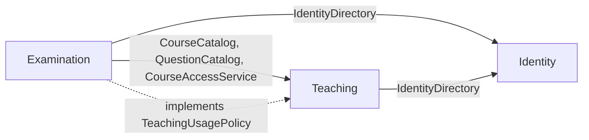

# Kiến trúc Modular Monolith của AIVES

Backend là một ứng dụng Spring Boot, một đơn vị triển khai JAR và một cơ sở dữ liệu PostgreSQL Neon. Bên trong ứng dụng có ba module nghiệp vụ, với hợp đồng công khai và phần triển khai nội bộ. Layered Architecture được sử dụng bên trong mỗi module.

## Module và trách nhiệm

| Module | Sở hữu | Hợp đồng cho module khác |
| --- | --- | --- |
| Identity | Tài khoản, mật khẩu, JWT, xác thực, bộ lọc bảo mật | IdentityDirectory và Account |
| Teaching | Môn học, phân công, ghi danh, học liệu, trích xuất văn bản, ngân hàng câu hỏi, sinh/import câu hỏi, rubric và duyệt | CourseAccessService, CourseCatalog, QuestionCatalog, các record dữ liệu và TeachingUsagePolicy |
| Examination | Đề/lịch thi, thí sinh, cấp bộ câu hỏi, lượt thi, TTS/STT, hỏi đào sâu, timeout, WebSocket và giám sát | Các endpoint HTTP/WebSocket hiện tại; triển khai TeachingUsagePolicy cho phần nội dung |

Các chức năng thi/phỏng vấn/giám sát nằm trong cùng module Examination vì cùng thao tác trạng thái và lịch sử lượt thi. Đây là ranh giới module lớn ban đầu; có thể tách nhỏ tiếp khi có nhu cầu nghiệp vụ cụ thể.



Đây là chiều phụ thuộc của code. Khi chạy, Teaching gọi TeachingUsagePolicy để kiểm tra kỳ thi đang mở, sinh viên đang thi hoặc câu hỏi trong đề. Interface thuộc Teaching; implementation thuộc Examination, nên Teaching không tham chiếu ngược đến controller, repository hoặc entity của Examination.

## Cấu trúc

```text
com.example.swd392_se1907_aives
├── Swd392Se1907AivesApplication
├── modules
│   ├── identity
│   │   ├── api                 # interface + record công khai
│   │   └── internal            # controller, service, repository, domain, security
│   ├── teaching
│   │   ├── api
│   │   └── internal
│   └── examination
│       ├── api                 # chỗ dành cho hợp đồng khi có consumer mới
│       └── internal
├── shared                      # ApiResponse và lỗi dùng chung
└── bootstrap                   # khởi động, nạp môi trường, OpenAPI, xử lý lỗi HTTP
```

Entity, repository và service triển khai là chi tiết nội bộ của module. Module khác chỉ sử dụng package `api`; không chia sẻ UserRepository, CourseRepository, QuestionRepository hoặc ExamRepository. Account không chứa mật khẩu/hash. Các record trao đổi là dữ liệu bất biến, không phải entity JPA được quản lý.

Các liên kết ORM chéo module được thay bằng UUID trên những cột hiện có. Quan hệ ORM trong cùng module được giữ. Tên bảng, tên cột và schema SQL được giữ nguyên; các ràng buộc khóa ngoại hiện có ở DB không được xóa.

Đã xóa package `compatibility` gồm các mapping Subject, SubjectDocument, ExamSession, ExamSchedule, InterviewLog và enum cũ vì không còn được nghiệp vụ hiện hành sử dụng. Các enum Teaching không còn tham chiếu và thư mục package ngang rỗng cũng đã được xóa. Việc dọn source không xóa bảng hay dữ liệu cũ trong database.

## Giao dịch và hành vi được giữ

- Một datasource và transaction manager cho cả ứng dụng.
- Khóa môn/kỳ thi/lượt thi vẫn giữ cùng phạm vi giao dịch như trước.
- CourseCatalog.findLockedById và TeachingUsagePolicy.prepareQuestionChange yêu cầu giao dịch của bên gọi bằng Propagation.MANDATORY, không mở giao dịch độc lập làm mất khóa giữa chừng.
- Quyền ADMIN/LECTURER/STUDENT, API `/api/v1`, WebSocket, JSON DTO và cơ chế kiểm soát thời gian không đổi.
- Cấu hình Neon, OpenAI, JWT, CORS và kho tệp tiếp tục dùng cấu hình hiện có.
- Không chạy lại schema/seed và không di chuyển dữ liệu để đổi package Java.

## Kiểm tra ranh giới

ModuleArchitectureTests đọc bytecode production bằng ASM có sẵn trong Spring, bao gồm lời gọi trong thân phương thức và getter do Lombok sinh. Kiểm tra:

1. Chỉ phụ thuộc vào API công khai của module khác.
2. Identity không phụ thuộc Teaching/Examination; Teaching chỉ phụ thuộc Identity; Examination được phụ thuộc cả hai.
3. Không có chu trình phụ thuộc; business module không sử dụng bootstrap như đường vòng.
4. Hợp đồng công khai chỉ gồm interface và immutable record; không lộ kiểu nội bộ qua chữ ký phương thức/constructor.
5. Controller/repository và entity nằm trong module sở hữu; các package ngang `controller`, `service`, `repository`, `domain` cũ và `compatibility` không còn trong output của bản build mới.
6. Một fixture bytecode cố tình gọi repository module khác xác nhận bộ đọc bắt được phụ thuộc trong thân phương thức.

Không cần đưa thêm framework để thực hiện Modular Monolith. Việc áp dụng Spring Modulith trong tương lai là lựa chọn công cụ riêng.

## Build và chạy sau lần chuyển kiến trúc này

Do đổi package, class cũ còn trong `target/classes` có thể gây trùng Spring bean nếu chỉ biên dịch chồng lên output cũ.

Trong IntelliJ: **Stop backend → Build / Rebuild Project → Run**. Không rebuild/xóa output của JVM cũ giữa một ca thi đang diễn ra. Main class vẫn là `com.example.swd392_se1907_aives.Swd392Se1907AivesApplication`.

Với Maven, sau khi đã Stop backend:

```powershell
.\mvnw.cmd clean package
java -jar target/SWD392_SE1907_AIVES-0.0.1-SNAPSHOT.jar
```

Có thể kiểm tra build ở thư mục riêng khi tiến trình cũ vẫn đang dùng target/classes:

```powershell
.\mvnw.cmd -Daives.build-directory=target/modular-validation package
```

Tùy chọn này được dùng để kiểm thử bản chuyển đổi. Không trộn class cũ với class của cấu trúc module mới. Frontend tiếp tục dùng các endpoint cũ; chỉ cần tải lại trang sau khi backend mới chạy.

## Xác nhận bản chuyển đổi

- Maven package thành công với **80 kiểm thử backend**, gồm bốn kiểm thử kiến trúc; các kiểm tra kiến trúc bổ sung cũng đã chạy lại thành công.
- JAR được tạo tại `target/modular-validation/SWD392_SE1907_AIVES-0.0.1-SNAPSHOT.jar`.
- Đối chiếu source trước/sau chuyển module: giữ các khai báo mapping của **16 REST controller (94 mapping annotation)** và tên bảng/cột của các entity. Sau khi dọn package không dùng, còn **22 entity** thuộc các module nghiệp vụ; năm mapping legacy được loại bỏ khỏi source, bảng dữ liệu vẫn giữ nguyên.
- Frontend build thành công; **21 kiểm thử API/turn detection** và **32 kiểm thử Playwright** thành công.
- Backend dùng H2 trong các kiểm thử; phần giao diện dùng API/micro giả lập. Không chạy migration hay ghi vào dữ liệu Neon để đổi cấu trúc code.
- Sau khi xóa package không dùng, Maven package chạy lại thành công với **80 kiểm thử backend, không lỗi**. JAR của lần kiểm tra này ở `target/package-cleanup-validation/SWD392_SE1907_AIVES-0.0.1-SNAPSHOT.jar`.
